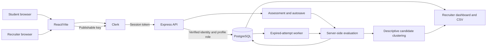
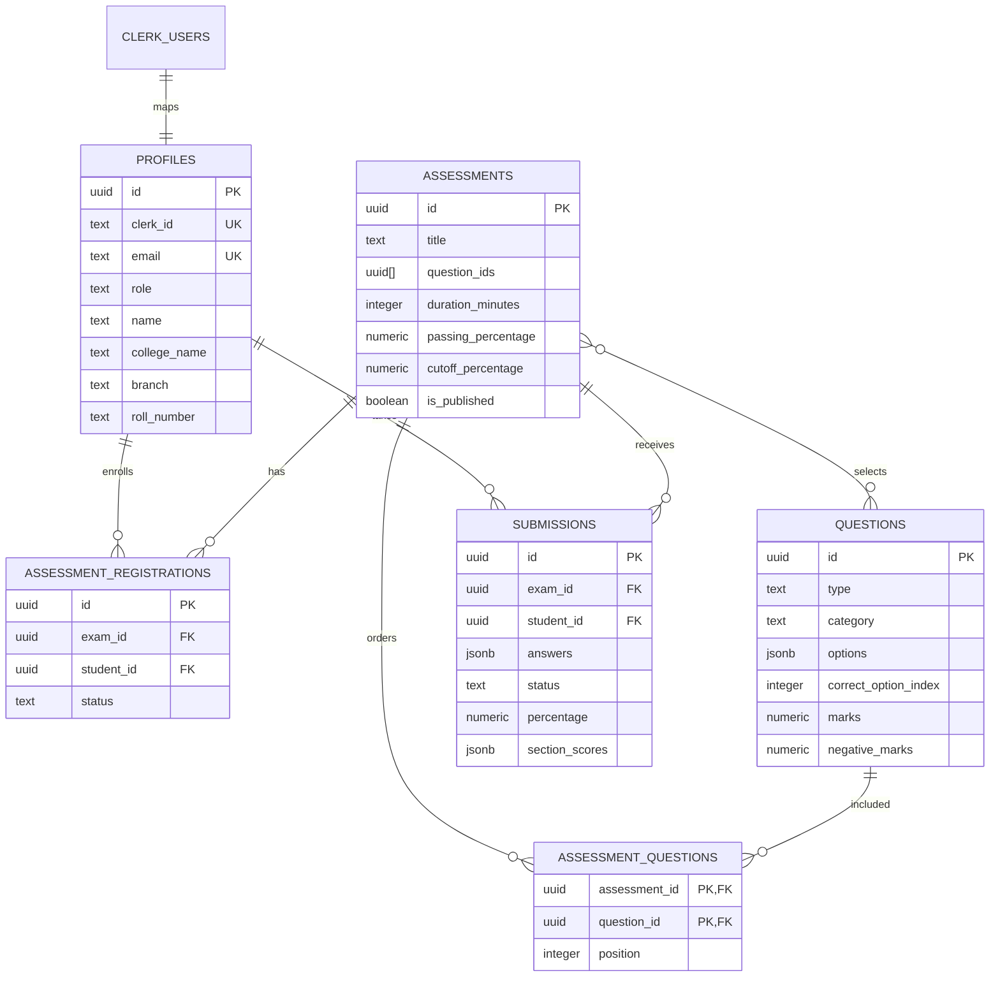

# UHO Campus Assessment Platform

## Technical Approach

Clerk provides email/password authentication and verified sessions. The React/Vite client obtains Clerk session tokens; Express verifies those tokens, links verified email addresses to PostgreSQL profiles, and enforces profile roles. PostgreSQL stores profiles, questions, assessments, registrations, and submissions.

## Architecture

Express verifies Clerk tokens before protected operations, checks application roles from PostgreSQL, and keeps database credentials server-side. The API strips correct answers from test-taking responses. Clerk handles email verification, sessions, refresh, and sign-out.

## Database Schema

The deployable schema is [`../backend/migrations/001_initial_schema.sql`](../backend/migrations/001_initial_schema.sql).

Unique constraints prevent duplicate candidate enrollment and attempts per assessment. Indexes cover category/difficulty, published assessment windows, registrations by candidate, and submissions by assessment/status/score. The database is accessed only by the backend using a server-side connection string; every protected API request requires a valid Clerk session and candidate/admin role.

## Main Modules

- Clerk: email/password signup, email confirmation codes, login, refresh, and logout.
- Candidate profiles: education details use stable PostgreSQL UUIDs; verified Clerk emails link accounts to existing profiles, and new public signups receive the `student` role.
- Question bank and assessment CRUD: database-backed MCQs, schedules, categories, cutoffs, randomization, and publication state. Legacy coding questions are excluded from candidate assessments.
- Student attempts: one attempt per assessment, randomized orders persisted, debounced autosave, local recovery, deadlines, and server-side evaluation.
- Expired-attempt worker: each API instance checks expired MCQ attempts every five seconds. `FOR UPDATE SKIP LOCKED` plus an evaluation lease token prevents two instances from evaluating the same attempt; stale claims can be recovered.
- Security controls: database-time deadline checks prevent late answer replacement; active student responses omit answer keys; API and sensitive route groups use per-account/IP rate limits; unexpected server errors are logged and returned with generic messages. Rate-limit counters use an in-memory store per API process unless a shared store is configured.
- Recruiter reporting: live polling, tied ranks, filtering, auto/manual shortlist, college/section analytics, CSV, performance profiles, and descriptive question difficulty/discrimination statistics.

Admins can access the candidate directory and this platform overview from the admin navigation. Assessment reports can be downloaded as CSV or printed/saved to PDF from the browser. Multi-drive/batch entities and native XLSX/PDF generation are not implemented.

## AI/ML

Recruiter reports run K-means over completed candidates' section percentages using up to three clusters. Profile size, mean result, and relative strongest section are descriptive signals only; they do not make hiring decisions or modify shortlisting. Reports also calculate MCQ difficulty (fraction correct) and a top/bottom score-group discrimination index when enough responses are available. These item statistics are descriptive analysis, not a trained predictor or full IRT model.

## Security, Email, and Capacity

- Configure email/password and email verification in the selected Clerk application, and allow the local/deployed origins. Clerk sends verification email; no SMTP password is stored in the app.
- The Clerk publishable key belongs in the frontend. The Clerk secret key and PostgreSQL connection string are backend-only and must never be exposed to a browser.
- Promote admin roles only through the controlled backend seeder or database administration.
- API ownership and role checks precede all database access. Do not expose the PostgreSQL connection string to the browser.
- For 1,000+ concurrent candidates, load-test Auth email throughput, database connections/query latency, API replicas, and rate-limit storage. This project has not been load-tested at that volume.
- Candidate-submitted code is not executed. Only MCQ questions can be added to new assessments.
- The database migration runner applies all ordered SQL files. Run `npm run migrate` before starting the updated backend so `evaluation_token` and the relational `assessment_questions` mapping exist.

## Local Setup

1. Apply `backend/migrations/001_initial_schema.sql` to PostgreSQL.
2. Set `VITE_CLERK_PUBLISHABLE_KEY` in `frontend/.env.local`.
3. Set `DATABASE_URL`, `CLERK_PUBLISHABLE_KEY`, `CLERK_SECRET_KEY`, and `ADMIN_EMAIL` in `backend/.env`.
4. Optionally copy existing rows while preserving profile UUIDs, then run `npm run seed --prefix backend`, `npm run dev --prefix backend`, and `npm run dev --prefix frontend`.
5. Check `http://localhost:5000/api/health` before testing signup/API flows.